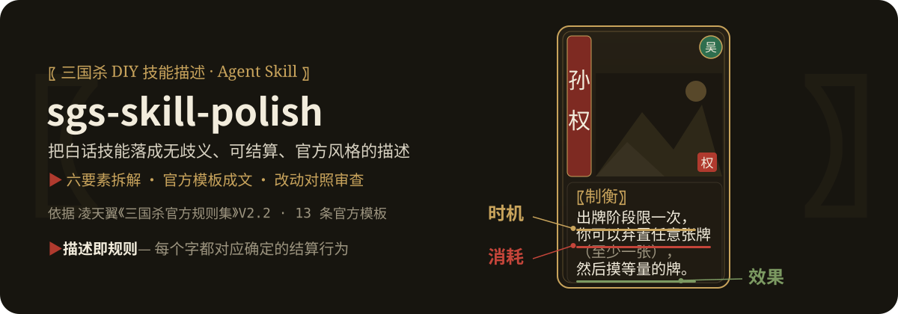
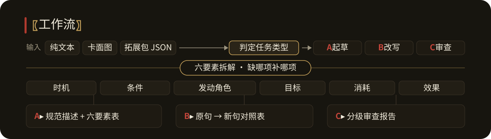

<p align="center">
  
</p>

依据《三国杀官方规则集》(凌天翼)优化三国杀 DIY 武将技能描述的 Agent Skill:让 Agent 把白话技能落成**无歧义、可结算、官方风格**的描述,而不是"看起来像那么回事"的改写。

> **一个真实的歧义**——〖拼将一死〗"出牌阶段，你可以弃置一张牌，然后你弃置他一张牌。"
> 后半句主语不明："你弃置他的一张牌"是**你**选牌，"令他弃置一张牌"是**他**选牌，两种措辞两种结算。
> 本 Skill 会指出歧义、按规则集用语章改写为精确表述，用 ▶ 分隔消耗与效果，并附注明出处的改动对照表。

## 它做什么

<p align="center">
  
</p>

- **三种任务分型**:起草(拆设计意图→套官方模板成文)、改写(逐句对照规则集,附改动对照表)、审查(只读找漏洞,用两种可能结算证明歧义真实存在)
- **六要素拆解**:时机/条件/发动角色/目标/消耗/效果,缺哪项补哪项;状态类技能无时机;一个技能最多一个消耗
- **官方结构模板**:13 条官方技能原文(〖制衡〗〖放权〗〖刚烈〗〖权计〗〖离间〗〖流离〗等),覆盖纯触发/消耗▶效果/延时效果/判定分支/锁定状态/标记数值/转化技/觉醒技/主公技/目标转移
- **用词硬规则**:"可"决定一切可选性、"弃置"主语(谁选牌)、获得 vs 得到、无效/取消/防止/无视之分、距离与手牌上限的 max{} 下限保护、"等量"与"一半"的精确定义
- **标准输出**:规范版描述 + 六要素表 + 边界情况备注;改写另有"原句→新句→理由(注明规则集出处)"对照表

## 安装

<p align="center">
  
</p>

把本目录复制到宿主的 skills 目录,例如:

```text
~/.zcode/skills/sgs-skill-polish/
```

或使用 skills CLI:

```bash
npx skills add Haoo-7/sgs-skill-polish
```

## 使用

<p align="center">
  
</p>

对 Agent 说:

- "帮我把〖拼将一死〗的技能描述按官方规则集规范化"(流程 B,出对照表)
- "审查这个技能描述有没有结算漏洞,先别改"(流程 C,只读)
- "新武将技能是……帮我写成规范描述"(流程 A)
- 直接给武将拓展包 JSON 或卡面图也行,写回时只改描述字段

**不会**触发:编写 FreeKill/新月杀 Lua 实现(交给 [freekill-general-authoring](https://github.com/Haoo-7/freekill-general-authoring))、与描述撰写无关的规则答疑、制作卡面图片或调整排版样式。

## 目录结构

<p align="center">
  
</p>

```text
SKILL.md                                           # 主流程:任务分型/六要素/官方模板/自查清单/输出格式
assets/readme/                                     # README 视觉素材(hero/工作流/章节横幅,纯 SVG)
references/速查-用语与符号.md                        # 符号系统、时机命名、操作动词精确定义、数值公式、易错点
references/三国杀官方规则集V2.2（规则+用语原文）.md     # 游戏规则+游戏用语全章原文(最终权威)
references/三国杀官方规则集V1.0配套卷（流程+卡牌）.pdf  # 事件结算流程+全部官方技能描述(风格范例库)
evals/evals.json                                   # 效果评估集(4 条)
evals/trigger-eval-set.json                        # 触发测试集(5 正例 5 反例)
```

## 兼容与边界

<p align="center">
  
</p>

- 规则依据为凌天翼《三国杀官方规则集》(V2.2 参考文本 + V1.0 配套卷,玩家整理);速查手册与原文冲突时以原文为准
- 输入支持纯文本、卡面图(先放大逐字确认)和武将拓展包 JSON;写回 JSON 时只改描述文本字段,不动排版配置
- 触发测试集已备好,效果前后对照可按 [oil-skill-creator](https://github.com/oil-oil/oil-skill-creator) 评估流程运行;静态校验通过不代表触发准确,以实测为准

## 致谢

<p align="center">
  
</p>

结构与校验按 [oil-skill-creator](https://github.com/oil-oil/oil-skill-creator) 的方法论整理;规则文本源自玩家整理的 [sgsrule](https://github.com/zz412000428/sgsrule) 项目与配套卷,版权归原整理者所有,仅作 Skill 的参考依据使用。
